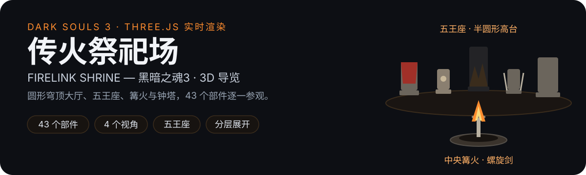
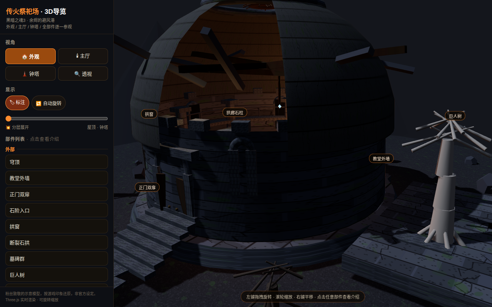
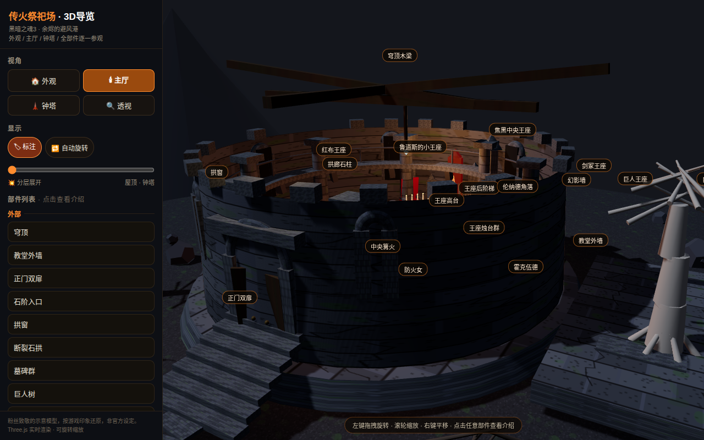

<p align="right"><a href="README.md">中文</a></p>

<p align="center">
  
</p>

<p align="center">
  <a href="https://holynova.github.io/firelink-shrine-ds3/">▶ Visit Online</a>
  ·
  <a href="https://github.com/holynova/firelink-shrine-ds3">GitHub Repository</a>
</p>

An interactive Three.js tour of the Firelink Shrine from Dark Souls 3: the round domed hall, the five thrones on their semicircular dais, the bonfire with its Coiled Sword, and the eastern bell tower — 43 labelled parts, each with its in-game story.

## Screenshots

<p align="center">
  
  
</p>

## The Tour

- **4 views**: 外观 exterior (dome and grounds), 主厅 main hall (thrones and bonfire), 钟塔 bell tower (eastern towers), and 透视 X-ray (walls hidden to reveal the interior).
- **43 parts in 4 groups**: exterior 11 (穹顶 dome, 正门双扉 main doors, 巨人树 giant tree, 墓碑群 graves, 剑圣之地 sword master grounds…), main hall 16 (五王座 the five thrones, 中央篝火 bonfire, 防火女 Fire Keeper, 霍克伍德 Hawkwood, 幻影墙 illusory wall…), lower level 8 (地道 tunnel, 祭祀场侍女 Shrine Handmaid, 铁匠安德烈 Blacksmith Andre and his forge), tower 8 (塔门 tower door, 钟塔 bell tower, 大钟 great bell, 断裂石桥 broken bridge, 升降机 lift, 防火女之魂 Fire Keeper Soul).
- **Five distinct thrones**: 红布王座 red-cloth throne, 鲁道斯的小王座 Ludleth's small plain throne (the only occupied one), 焦黑中央王座 the charred central throne, 剑冢王座 the sword-covered throne, and 巨人王座 the giant throne — researched from Fextralife and Fandom (see `REFERENCE.md`).
- **Interact**: click any part (or the sidebar list) for its story and a camera flight; toggles for labels and auto-rotate; an explode slider lifts the dome and tower to expose the interior.

## Controls

Left-drag to orbit · scroll to zoom · right-drag to pan · click a part for its story; the sidebar collapses on mobile.

## Run Locally

No build step — serve over http(s) (`python3 -m http.server 8000`); don't open with `file://` directly, and note Three.js loads from a CDN, so it needs internet.

```bash
python3 -m http.server 8000
# Open http://localhost:8000
```

## Tech

- Three.js 0.160 (CDN import map) + OrbitControls; all geometry generated in code, no external model files.
- Part system: `defPart()` defines 43 parts (name / group / description / viewing direction); picking one triggers a camera flight and highlight; view modes toggle wall visibility.
- `REFERENCE.md`: research notes (each of the five thrones, the tower route, and the v1 mismatch list).

```
index.html          Entry: sidebar (views / display / parts list) + canvas
app.js              Three.js scene: 43 parts, 4 views, labels and picking
REFERENCE.md        Research notes
```
