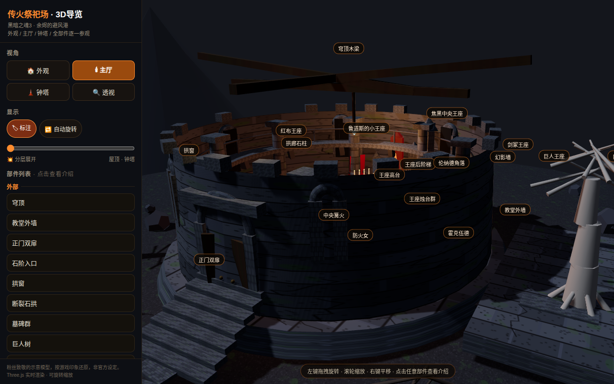

<p align="right"><a href="README.en.md">English</a></p>

<p align="center">
  
</p>

<p align="center">
  <a href="https://holynova.github.io/firelink-shrine-ds3/">▶ 在线参观</a>
  ·
  <a href="https://github.com/holynova/firelink-shrine-ds3">GitHub 仓库</a>
</p>

《黑暗之魂3》传火祭祀场的 Three.js 3D 导览：圆形穹顶大厅、五王座半圆形高台、中央篝火与东部钟塔，43 个部件逐一参观，每个部件都有游戏内的来历介绍。

## 截图

<p align="center">
  
  
</p>

## 导览内容

- **4 个视角**：外观（穹顶与庭院）、主厅（王座与篝火）、钟塔（东侧塔楼群）、透视（墙体隐藏，看清内部结构）。
- **43 个部件，分 4 类**：外部 11（穹顶、正门双扉、巨人树、墓碑群、剑圣之地……）、主厅 16（五王座、中央篝火、防火女、霍克伍德、幻影墙……）、下层 8（地道、祭祀场侍女、铁匠安德烈与锻炉四件套）、塔楼 8（塔门、钟塔、大钟、断裂石桥、升降机、防火女之魂）。
- **五王座各不相同**：红布王座、鲁道斯的小王座（唯一有主的王座）、焦黑中央王座、剑冢王座、巨人王座——按 Fextralife 与 Fandom 考据还原，见 `REFERENCE.md`。
- **互动**：点任意部件（或左侧列表）查看介绍并飞镜聚焦；标注开关、自动旋转、分层展开滑杆（屋顶与钟塔升起，露出内部）。

## 操作

左键拖拽旋转 · 滚轮缩放 · 右键平移 · 点击部件查看介绍；移动端侧栏可收起。

## 本地运行

零构建，直接起一个静态服务器打开即可（ES Module 需经 http(s)，不要用 `file://` 直接打开；Three.js 走 CDN，需联网）：

```bash
python3 -m http.server 8000
# 打开 http://localhost:8000
```

## 技术

- Three.js 0.160（CDN import map）+ OrbitControls；全部几何体由代码生成，无外部模型文件。
- 部件系统：`defPart()` 定义 43 个部件（名称 / 分类 / 描述 / 观看方向），点击拾取后飞镜 + 高亮；视角模式切换墙体可见性。
- `REFERENCE.md`：考据笔记（五王座逐一描述、塔楼路线、旧版 v1 与游戏不符的问题清单）。

```
index.html          入口：侧栏（视角 / 显示 / 部件列表）+ 画布
app.js              Three.js 场景：43 个部件、4 个视角、标注与拾取
REFERENCE.md        考据笔记
```
