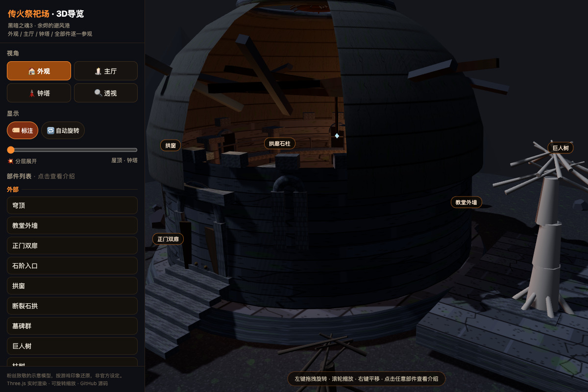

# Firelink Shrine DS3 3D / 传火祭祀场 · 黑魂3 3D导览

中文：基于 Three.js 制作的《黑暗之魂3》传火祭祀场 3D 立体导览。完整重现五大薪王王座、中央篝火殿堂、钟塔与灰烬之墓通道，支持外观、殿堂、王座与透视视角切换、分层展开、自动旋转与空间部件点击导览。

English: Interactive 3D walk-through of Firelink Shrine from Dark Souls 3 built with Three.js. Recreates five Lord thrones, central bonfire hall, bell tower, and cemetery corridors with multi-view controls, exploded layer controls, and interactive annotations.



## 在线体验 / Live Demo

- [Cloudflare Demo](https://xiaosang.cc/firelink-shrine-ds3/)
- [GitHub Repo](https://github.com/holynova/firelink-shrine-ds3)


## 本地运行 / Run locally

```bash
python3 -m http.server 8000
```

## 发布 / Deploy

```bash
npx wrangler deploy --config wrangler.jsonc
```

Cloudflare Workers · Domain: `xiaosang.cc` · Route: `/firelink-shrine-ds3/`

源码与部署配置使用同一个主分支（main）；在本地手动发布，不创建 Cloudflare 专用分支或 GitHub Action。
